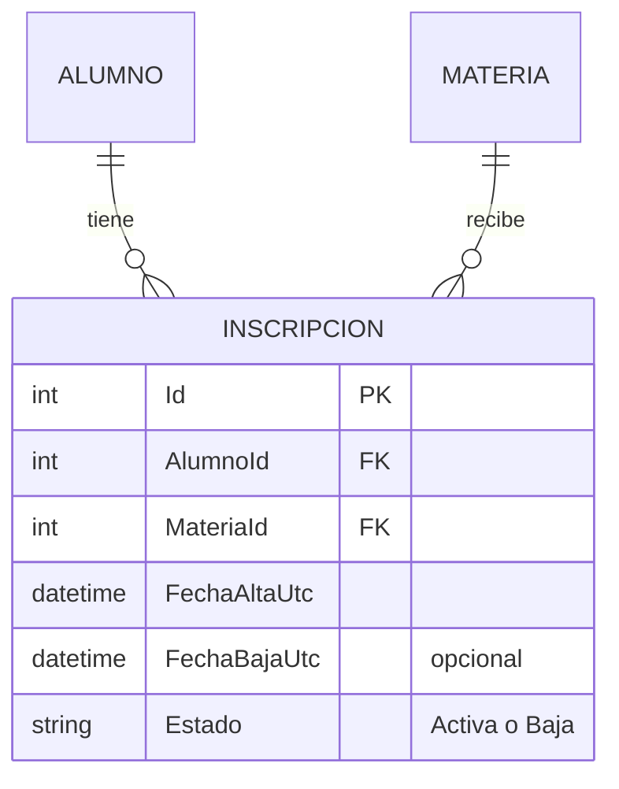

# Gestión académica con .NET 8 y Angular 20

Trabajo práctico de APIs para gestionar alumnos, materias e inscripciones. El backend expone una API REST con ASP.NET Core, Entity Framework Core y SQL Server, organizada en capas (Clean Architecture). El frontend usa Angular y Angular Material. El proyecto incluye registro e inicio de sesión con BCrypt y JWT, autorización por roles, listados paginados con filtros, manejo global de errores, un módulo de **Inscripciones** (un alumno cursa varias materias) y un **Dashboard Académico**.

Estado actualizado el 2026-11-17, después de aplicar el plan de este documento y las dos funciones de [Inscripciones y Dashboard Académico](#inscripciones-y-dashboard-académico). Los resultados de compilación y pruebas de la sección [Pruebas y defensa](#pruebas-y-defensa) son de esa fecha.

## Cumplimiento de las consignas

| Consigna | Estado | Evidencia o trabajo pendiente |
|---|---|---|
| API propia | Implementada | CRUD de alumnos y materias, inscripciones, dashboard académico y endpoints de registro e inicio de sesión. Swagger en desarrollo, con el botón *Authorize* para pegar el JWT. |
| ORM | Implementado | Entity Framework Core 8, proveedor SQL Server y `AppDbContext` (en `CLASE_ORM.Infrastructure`). |
| Base de datos Code First | Implementado y verificado | Entidades y migraciones `init`, `AddProfesor`, `AddEmail`, `AddUsuario`, `AddRolUsuario`, `AlumnoMateriaSinCascada` y `AddInscripciones`. Se aplicaron sobre una base vacía y sobre una base con datos (se conservaron; cada materia de un alumno pasó a ser una inscripción activa). Falta demostrarlo en la defensa. |
| Frontend Angular | Implementado | Angular 20 con listados paginados y filtrables, formularios, navegación, autenticación, inscripciones, dashboard y manejo de errores. |
| Angular Material (mínimo tres componentes) | Implementado | `MatTable` (listados), `MatDialog` (altas y ediciones) y `MatPaginator` (paginación). Además `MatFormField`, `MatInput`, `MatSelect` y `MatButton`. |
| Clean Architecture | Implementada | Cuatro proyectos: `Domain`, `Application`, `Infrastructure` y `Api` (`CLASE_ORM`). Ver [Estructura actual](#estructura-actual). |
| Autorización por roles | Implementada | `Admin` (altas, cambios y bajas) y `Consulta` (lecturas). El rol se guarda en `Usuarios.Rol`, viaja en el JWT y se aplica con `[Authorize(Roles = ...)]`. |
| Paginación y filtrado | Implementada | `GET /api/Alumno?page&pageSize&search`, `GET /api/Materia?page&pageSize&search` y `GET /api/inscripciones?page&pageSize&alumnoId&materiaId&estado`. `MatPaginator`, buscador y filtros en Angular. |
| Middleware personalizado | Implementado | `RequestLoggingMiddleware` registra método, ruta, estado, duración, usuario y `traceId` de cada petición. |
| Gestión global de excepciones | Implementada | `GlobalExceptionHandler` devuelve `ProblemDetails` (JSON) con `traceId`. Angular muestra los mensajes y los errores por campo. |
| Inscripciones (un alumno cursa varias materias) | Implementada | Entidad `Inscripcion`, índice único filtrado por estado activo, migración que conserva los datos, `POST/GET/PATCH /api/inscripciones` y la pantalla `/inscripciones`. Ver [Inscripciones y Dashboard Académico](#inscripciones-y-dashboard-académico). |
| Dashboard Académico | Implementado | `GET /api/dashboard-academico` y la pantalla `/dashboard-academico` (antes Dashboard C), con tarjetas `MatCard` y filtro por materia. |

## Estructura actual

| Ruta | Contenido |
|---|---|
| `CLASE_ORM.Domain/` | Entidades (`Alumno`, `Materia`, `Inscripcion`, `Profesor`, `Usuario`), el estado de la inscripción y los roles. No depende de ningún otro proyecto. |
| `CLASE_ORM.Application/` | Casos de uso (`Services`), DTO con sus validaciones, contratos (`Interfaces`: repositorios, `IUnitOfWork`, `IPasswordHasher`, `ITokenService`) y excepciones de aplicación. Referencia a `Domain`. |
| `CLASE_ORM.Infrastructure/` | EF Core (`AppDbContext`, repositorios, la consulta del dashboard, migraciones), BCrypt, generación del JWT y el sembrado del administrador. Implementa los contratos de `Application`. |
| `CLASE_ORM/` (Api) | Controladores, middleware, manejador global de errores y `Program.cs` (inyección de dependencias, JWT, CORS y Swagger). |
| `TestAngular/` | Vistas de alumnos, materias, inscripciones y dashboard, formularios de autenticación, servicios HTTP, guard, interceptor y pruebas. Incluye `Dockerfile` y `nginx.conf`. |
| `docker-compose.yml`, `CLASE_ORM/Dockerfile`, `docker/` | Sistema completo en contenedores (web, API y SQL Server) y el script de datos de ejemplo. Ver [Ejecución con Docker](#ejecución-con-docker). |

Dirección de las dependencias (siempre hacia el núcleo):

```
CLASE_ORM (Api) ───────▶ CLASE_ORM.Application ───▶ CLASE_ORM.Domain
      │                          ▲                         ▲
      └──▶ CLASE_ORM.Infrastructure ─────────────────────┘
           (implementa los contratos de Application; la Api solo la usa para registrarla en Program.cs)
```

Una solicitud viaja así: Angular → `Controller` (Api) → servicio de `Application` (caso de uso) → interfaz de repositorio → repositorio de `Infrastructure` → EF Core → SQL Server. Los controladores y los servicios no conocen EF Core.

| Recurso | Operaciones | Acceso |
|---|---|---|
| `/api/Alumno` | `GET` listado paginado (`search` por nombre o email) y `POST` alta. Usar `/{id}` para `GET`, `PUT` y `DELETE`. Solo datos personales: las materias se gestionan desde inscripciones. | Lectura: `Admin` o `Consulta`. Escritura: `Admin`. |
| `/api/Materia` | `GET` listado paginado y `POST` alta. Usar `/{id}` para `GET`, `PUT` y `DELETE`. `GET /api/Materia/todas` devuelve todas sin paginar, para los desplegables. | Lectura: `Admin` o `Consulta`. Escritura: `Admin`. |
| `/api/inscripciones` | `GET` listado paginado con filtros, `POST` inscribir, `GET /{id}` y `PATCH /{id}/baja`. | Lectura: `Admin` o `Consulta`. Escritura: `Admin`. |
| `/api/dashboard-academico` | `GET` resumen general, o de una materia con `?materiaId=`. | `Admin` o `Consulta` |
| `/api/Auth/registro` y `/api/Auth/login` | `POST` para registrar o iniciar sesión y recibir un JWT. El registro público siempre crea usuarios `Consulta`. | Público |

Los listados devuelven `{ items, totalCount, page, pageSize }` y las altas responden `201 Created`. Los errores tienen siempre el formato `ProblemDetails`:

| Código | Cuándo | Ejemplo |
|---|---|---|
| `400` | Datos inválidos o parámetros fuera de rango. Trae `errors` por campo. | `{ "title": "Error de validación", "errors": { "AlumnoId": ["Tenés que elegir un alumno."] }, "traceId": "..." }` |
| `401` | Sin token, token vencido o credenciales incorrectas. | `{ "title": "No autenticado", "detail": "Email o contraseña incorrectos." }` |
| `403` | El rol no alcanza (por ejemplo `Consulta` intentando escribir). | `{ "title": "Acceso denegado", "detail": "No tenés permisos para realizar esta acción." }` |
| `404` | El recurso no existe. | `{ "title": "Recurso no encontrado", "detail": "No existe el alumno con id 999." }` |
| `409` | Conflicto con los datos: email ya registrado, inscripción activa repetida, o borrar un alumno o una materia que tienen inscripciones. | `{ "title": "Conflicto", "detail": "Ana Perez ya tiene una inscripción activa en Algebra." }` |
| `500` | Falla inesperada. Mensaje genérico y `traceId`; el detalle técnico queda en el log del servidor. | `{ "title": "Error interno del servidor", "traceId": "..." }` |

Un alumno puede cursar varias materias (tabla `Inscripciones`). Como el historial se conserva, **no se puede eliminar un alumno ni una materia que tengan inscripciones**, activas o de baja: la API responde `409` y las claves foráneas no tienen cascada (`Restrict`). Profesor existe como entidad y tabla, sin pantalla ni endpoints.

## Inscripciones y Dashboard Académico

Un alumno puede cursar varias materias y una materia tiene varios alumnos. La relación es una entidad propia, `Inscripcion`, que registra cuándo empezó y cuándo terminó:



**Reglas del módulo**

- Una baja **no borra** la fila: queda con `Estado = Baja` y su `FechaBajaUtc`. Después se puede reinscribir al alumno en la misma materia y el historial queda completo.
- Un alumno no puede tener **dos inscripciones activas en la misma materia**. Lo controla la aplicación (`409` con un mensaje claro) y además lo garantiza la base con un índice único **filtrado** sobre `(AlumnoId, MateriaId)` donde `Estado = 'Activa'`. Así, si dos altas llegan al mismo tiempo, la segunda también termina en `409` y no en un error `500`.
- Dar de baja dos veces es seguro: la segunda responde `204` y conserva la fecha de la primera.
- Los datos que ya existían se migraron: cada alumno con una materia pasó a tener una inscripción activa (con la fecha de la migración, porque el modelo anterior no guardaba la de alta). La migración verifica que no falte ninguna antes de quitar `Alumnos.MateriaId` y se cancela entera si algo no coincide.

| Método y ruta | Roles | Resultado |
|---|---|---|
| `POST /api/inscripciones` | Admin | Recibe `alumnoId` y `materiaId`. `201` con la inscripción; `400` ids inválidos; `404` si no existe el alumno o la materia; `409` si ya hay una activa. |
| `GET /api/inscripciones` | Admin, Consulta | Listado paginado (`items`, `totalCount`, `page`, `pageSize`) con `alumnoId`, `materiaId` y `estado` (`Activa` o `Baja`). Orden: más nuevas primero, desempata por `Id`. |
| `GET /api/inscripciones/{id}` | Admin, Consulta | Una inscripción, o `404`. |
| `PATCH /api/inscripciones/{id}/baja` | Admin | `204` (también si ya estaba de baja); `404` si no existe. |
| `GET /api/dashboard-academico?materiaId=` | Admin, Consulta | Resumen. `404` si la materia no existe, `400` si el id no es válido. |

**Dashboard Académico.** Devuelve `totalAlumnosRegistrados`, `totalMateriasRegistradas`, `totalInscripcionesActivas`, `alumnosInscriptosActivos` e `inscripcionesPorMateria` (`materiaId`, `nombre`, `cantidadActivas`, incluidas las materias con cero). Con `materiaId`, las inscripciones activas, los alumnos inscriptos distintos y el detalle se limitan a esa materia; los dos totales de registros siguen siendo globales. Los conteos se resuelven en SQL Server. En la pantalla, la tarjeta de alumnos dice **Alumnos registrados** sin filtro y **Alumnos inscriptos en la materia** al filtrar.

**Pantallas.** `/inscripciones` (`MatTable`, `MatPaginator`, `MatSelect` para materia y estado, selector con búsqueda en el servidor para alumno, y `MatDialog` para el alta y la confirmación de baja) y `/dashboard-academico` (`MatCard`, `MatSelect` y `MatTable`). Ambas con estados de carga, vacío y error. Las acciones de escritura solo las ve el rol Admin. La ruta anterior `/dashboardC` redirige al dashboard.

## Ejecución con Docker

La forma más simple de correr (y de presentar) el sistema: **solo hace falta Docker Desktop**. No se instala .NET, Node ni SQL Server.

```bash
docker compose up --build -d      # la primera vez tarda 5 a 10 minutos (descarga imágenes)
docker compose run --rm seed      # opcional: usuarios, 8 materias, 12 alumnos y 22 inscripciones de ejemplo
```

En Windows alcanza con hacer doble clic en **`INICIAR-DEMO.bat`**: levanta el sistema, carga los datos de ejemplo y abre el navegador (`INICIAR-DEMO.bat reset` borra todo y arranca de cero).

Después abrí **http://localhost:8080**. Swagger está en `http://localhost:5201/swagger`. Usuarios que deja el script de datos:

| Rol | Email | Contraseña |
|---|---|---|
| Admin (puede crear, editar y borrar) | `admin@demo.local` | `Admin_Demo_2026` |
| Consulta (solo lectura) | `profesor@demo.local` | `Profesor_2026` |
| Consulta | `secretaria@demo.local` | `Secretaria_2026` |
| Consulta | `consulta1@demo.local` y `consulta2@demo.local` | `Consulta_2026` |

El administrador lo crea la API al arrancar (`AdminSeed__*` en `docker-compose.yml`); los de rol `Consulta` los registra el script por la API. "Registrarse" en la pantalla también crea usuarios `Consulta`: el rol Admin no se puede pedir por la API.

| Contenedor | Qué es |
|---|---|
| `web` | nginx con Angular compilado para producción. Reenvía todo lo que empieza con `/api` a la API, así el navegador habla con un solo servidor (sin CORS y sin puertos fijos en el código: `environment.ts` usa `apiUrl: '/api'`). |
| `api` | La API .NET 8. Al arrancar aplica las migraciones y crea la cuenta de administrador (`Database__MigrateOnStartup` y `AdminSeed__*`, definidos en `docker-compose.yml`). |
| `db` | SQL Server 2022 Express. Los datos viven en un volumen y sobreviven a `docker compose down`. No publica el puerto 1433, para no chocar con un SQL Server instalado en la compu. |
| `seed` | Un solo uso (`docker compose run --rm seed`, script en `docker/seed-demo.sh`): registra los usuarios de la tabla de arriba y carga 8 materias, 12 alumnos y 22 inscripciones (19 activas y 3 de baja, una de ellas reinscripta) por la API. Repetirlo no duplica nada. |

Comandos útiles: `docker compose ps` (estado), `docker compose logs -f api` (el log del middleware con método, ruta, estado, duración y `traceId`), `docker compose down` (apaga y conserva los datos) y `docker compose down -v` (apaga y borra todo). Si el puerto 8080 o el 5201 están ocupados, copiá `.env.example` como `.env` y cambiá `WEB_PORT` o `API_PORT`. Las contraseñas y la clave del JWT de `docker-compose.yml` son **de demostración**: para otro uso, definilas en `.env`.

**Llevarlo a otra compu.** Con internet alcanza copiar el proyecto y correr los comandos de arriba. Sin internet, o con una red lenta, se exportan las imágenes ya construidas (unos 2 GB) y se cargan en la otra compu:

```bash
docker compose build
docker save -o imagenes-docker.tar gestion-academica-api:demo gestion-academica-web:demo mcr.microsoft.com/mssql/server:2022-latest curlimages/curl:8.11.1
# en la otra compu, dentro de la carpeta del proyecto:
docker load -i imagenes-docker.tar
docker compose up -d              # sin --build: usa las imágenes cargadas
```

## Ejecución local sin Docker (desarrollo)

Se requiere .NET 8 SDK, SQL Server, `dotnet-ef` 8.x y una versión de Node.js compatible con Angular 20. El backend usa la cadena `ConnectionStrings:Con` y la configuración `Jwt`. Ajustá la conexión a tu instancia local y configurá los secretos fuera del archivo versionado. Por ejemplo, con `user-secrets` (el proyecto ya está habilitado):

```bash
cd CLASE_ORM
dotnet user-secrets set "ConnectionStrings:Con" "Server=...;Database=Practico;Trusted_Connection=True;TrustServerCertificate=True;"
dotnet user-secrets set "Jwt:Key" "una-clave-larga-y-aleatoria-de-al-menos-32-caracteres"
```

Los valores de `appsettings.json` siguen funcionando mientras no los reemplaces. La API se niega a arrancar si `Jwt:Key` tiene menos de 32 caracteres.

**Cuenta de administrador.** El registro público solo crea usuarios `Consulta`. Para tener un `Admin`, definí estas dos claves en el servidor (no están en `appsettings.json` a propósito):

```bash
cd CLASE_ORM
dotnet user-secrets set "AdminSeed:Email" "admin@ejemplo.com"
dotnet user-secrets set "AdminSeed:Password" "una-clave-segura"
```

Al arrancar, la API crea esa cuenta con rol `Admin`. Si ya existe un usuario con ese email, lo promueve a `Admin` sin tocar su contraseña. Si las claves no están definidas, no crea nada.

Desde la raíz, en una terminal:

```bash
cd CLASE_ORM
dotnet restore
dotnet ef database update
dotnet run --launch-profile https
```

`dotnet ef database update` aplica las migraciones que falten (las últimas son `AddRolUsuario`, `AlumnoMateriaSinCascada` y `AddInscripciones`): los usuarios existentes quedan con rol `Consulta` y no se pierde ningún dato. `AddInscripciones` convierte la materia que tenía cada alumno en una inscripción activa y recién después quita la columna `Alumnos.MateriaId`; si volvés atrás con `dotnet ef database update AlumnoMateriaSinCascada`, la reversión solo se hace cuando no se pierde nada (cada alumno con exactamente una inscripción activa, como justo después de migrar). Si ya hay historial o varias materias por alumno, se cancela antes de tocar la base y explica qué eliminar a mano. Para crear una migración nueva hay que indicar dónde viven: `dotnet ef migrations add Nombre --project ../CLASE_ORM.Infrastructure --startup-project . --output-dir Persistence/Migrations`.

La API usa `https://localhost:7197` y Swagger está en `/swagger` en desarrollo. Si el navegador rechaza el certificado de desarrollo, ejecutá `dotnet dev-certs https --trust` donde corresponda.

Desde la raíz, en otra terminal:

```bash
cd TestAngular
npm install
npm start
```

Abrí `http://localhost:4200`. Registrá una cuenta (queda como `Consulta`: puede ver alumnos en `/dashboardA`, materias en `/dashboardB`, `/inscripciones` y `/dashboard-academico`, sin botones de alta, edición ni baja). Para escribir, iniciá sesión con la cuenta `Admin`. El encabezado muestra el usuario y su rol. Si cambia el puerto de la API, ajustá la URL en `src/environments/`.

## Plan para terminar la entrega

1. **Estabilizar los CRUD.** Incluir `materiaId` en el DTO de alumno y precargarlo al editar. Cargar el nombre al editar materias. Validar que exista la materia asignada. Como política de borrado propuesta, bloquear la baja de materias con alumnos y devolver un `409` con un mensaje claro. Unificar la URL de la API entre servicios y entornos.
   - **Hecho.** El diálogo de materias precarga el nombre. Se corrigió la edición del alumno (precargaba mal la materia) y después la relación se rediseñó: el alumno ya no tiene materia directa, se gestiona desde Inscripciones (ver [Inscripciones y Dashboard Académico](#inscripciones-y-dashboard-académico)). Borrar una materia con inscripciones devuelve `409` con el motivo, y las claves foráneas no tienen cascada. Todos los servicios usan `environment`; la URL se define solo en `src/environments/`.
2. **Aplicar Clean Architecture.** Mover entidades y reglas a `Domain`. Ubicar casos de uso, DTO y contratos de persistencia en `Application`, que referencia a `Domain`. Mover EF Core, migraciones y las implementaciones de persistencia a `Infrastructure`, que referencia al núcleo. Mantener controladores, middleware y configuración HTTP en `Api`. La API conecta las implementaciones por inyección de dependencias. Conservar los datos y comprobar las migraciones tanto sobre la base existente como desde cero.
   - **Hecho.** Cuatro proyectos dentro de `CLASE_ORM.sln`. Los casos de uso solo dependen de interfaces (`IAlumnoRepository`, `IMateriaRepository`, `IUsuarioRepository`, `IUnitOfWork`, `IPasswordHasher`, `ITokenService`) y `Infrastructure` las implementa. Las migraciones se movieron a `Infrastructure` con sus espacios de nombres; EF no detecta cambios de modelo. Verificadas desde cero y sobre una base con datos.
3. **Autorizar por roles en la API.** Como esquema inicial, usar `Admin` para altas, cambios y bajas, y `Consulta` para lecturas. Persistir el rol, incluirlo en el JWT y aplicarlo en los endpoints. Asignar `Consulta` desde el servidor al registro público y crear la cuenta administrativa por un mecanismo controlado. Mostrar u ocultar acciones por rol en Angular y manejar `401` y `403`.
   - **Hecho.** Columna `Usuarios.Rol` y claim `role` en el token. Los controladores exigen `Admin` o `Consulta` para leer y `Admin` para escribir. El registro ignora cualquier rol que mande el cliente. La cuenta `Admin` se siembra desde la configuración del servidor (`AdminSeed`). En Angular, `Consulta` no ve los botones ni la columna de acciones, y el interceptor cierra la sesión y vuelve a `/login` ante un `401` (menos en las llamadas de `/Auth/`, donde el `401` es una clave incorrecta) y avisa ante un `403`.
4. **Paginar y filtrar listados.** En alumnos, por ejemplo, admitir `GET /api/Alumno?page=1&pageSize=10&search=ana&materiaId=2`. Validar parámetros, filtrar antes de contar y paginar, y aplicar un orden estable. Devolver `items`, `totalCount`, `page` y `pageSize`. Aplicar el mismo contrato a materias con búsqueda por nombre. Conectar `MatPaginator` y volver a la primera página al cambiar un filtro.
   - **Hecho.** `page` ≥ 1 y `pageSize` entre 1 y 100 (si no, `400`). La búsqueda de alumnos mira nombre y email. El orden es por nombre y luego por `Id`, así las páginas no repiten ni saltean filas. Una página fuera de rango devuelve `items` vacío con el `totalCount` correcto. En Angular: `MatPaginator`, búsqueda con espera de 300 ms, mensaje de "sin resultados" y regreso a la página 1 al cambiar un filtro (en Inscripciones: alumno, materia y estado). Si se borra la última fila de la última página, la vista retrocede sola.
5. **Agregar middleware personalizado y errores globales.** Un middleware propio puede registrar método, ruta, estado y duración de cada petición. Configurar también un manejador global con `ProblemDetails` para devolver `400` en validación, `404` si falta un recurso, `409` ante conflictos y `500` con mensaje genérico ante fallas inesperadas. Incluir un identificador de seguimiento, registrar el detalle técnico en el servidor y mostrar en Angular los mensajes o errores por campo.
   - **Hecho.** `RequestLoggingMiddleware` va primero en el pipeline y no registra cuerpos ni query string (no filtra contraseñas ni tokens). `GlobalExceptionHandler` traduce las excepciones de `Application` a `400`, `401`, `404` y `409`; cualquier otra devuelve `500` genérico y deja el stack en el log. Los mismos `traceId` aparecen en la respuesta y en el log. En Angular, los diálogos muestran los errores de campo debajo de cada input y las demás alertas muestran el `detail` que manda la API (con el `traceId` en los `500`).
6. **Confirmar el mínimo de Angular Material.** Verificar `MatTable` para el listado y `MatDialog` para altas y ediciones, y usar `MatPaginator` para navegar por los resultados. Mostrar los tres durante la defensa.
   - **Hecho.** `MatTable` + `MatPaginator` en `alumnos/`, `materia/` e `inscripciones/`; `MatDialog` en `dialog-agregar-alumno/`, `dialog-agregar-materia/`, `dialog-agregar-inscripcion/` y `dialog-baja-inscripcion/`; además `MatCard` en el dashboard y `MatAutocomplete` para elegir alumno o materia.

## Pruebas y defensa

Estado verificado el 2026-11-17:

| Comprobación | Resultado |
|---|---|
| `dotnet build CLASE_ORM.sln` | Sin errores. 2 advertencias, ambas por el nombre `init` de la migración original (CS8981). |
| Migraciones sobre una base vacía | Aplicadas las 7 migraciones; queda el índice único filtrado `UX_Inscripciones_AlumnoId_MateriaId_Activa`. |
| Migraciones sobre una base con datos | `AddInscripciones` convirtió 5 alumnos con materia en 5 inscripciones activas equivalentes (misma fecha de migración), quitó `Alumnos.MateriaId` y conservó el resto de los datos. |
| Reversión (`Down`) | No descarta información en silencio: con una inscripción activa por alumno revierte (y se puede volver a subir sin diferencias); con un alumno en varias materias, con inscripciones de baja o con un alumno sin ninguna, se cancela antes de tocar la base y la base queda como estaba. Probados los cuatro casos. |
| API con requests reales contra SQL Server | Sin fallas en todo lo anterior (roles, errores, paginación, CORS) y en Inscripciones: alta, mismo alumno en dos materias, duplicado (`409`), baja idempotente con fecha conservada, reinscripción con historial, filtros combinados, orden estable, validaciones (`400`/`404`), permisos (`401`/`403`) y borrados que respetan el historial. |
| Altas simultáneas | 3 corridas de 80 `POST` idénticos a la vez: siempre 1 `201` y 79 `409`, ningún `5xx`. En 20 intentos la que frenó fue la base (el índice único) y no la aplicación. |
| Dashboard con datos conocidos | 2 alumnos, 3 materias, 3 inscripciones. Filtrando la materia con dos inscripciones se ven 2 y 2; tras una baja, esa materia muestra 1 y el total general baja de 3 a 2; la tercera materia muestra 0 con su fila. |
| `ng build` (desarrollo y producción) | Sin errores. |
| `ng test` | 123 de 123 pruebas pasan. |
| Docker Compose | Las 3 imágenes se construyen y el sistema arranca solo (migraciones, administrador, nginx). El recorrido completo en el navegador real contra `http://localhost:8080` pasó sin fallas ni errores de consola. Los datos sobreviven a `docker compose down`; el script de ejemplo registra 4 usuarios `Consulta` (cada uno entra con su rol y recibe `403` al escribir) y carga 8 materias, 12 alumnos y 22 inscripciones, y no duplica al repetirse. `INICIAR-DEMO.bat` se probó con datos ya cargados y con `reset` desde cero. Probado también desde cero como en otra compu: sin las imágenes, con `docker load` y `docker compose up -d`, sin descargar ni construir nada. |
| Borrados en el navegador real | Alumno o materia con una inscripción activa, o con una sola de baja: aviso con el motivo y la fila sigue en la tabla (`409`). Sin inscripciones: se elimina y desaparece de la tabla. El historial de bajas queda intacto. |
| Navegador real (Edge) contra la API por HTTPS | Recorrido completo sin fallas: login, alta con selector con búsqueda, duplicado con su mensaje, filtros, baja con confirmación, reinscripción, dashboard con y sin filtro, usuario `Consulta` sin acciones de escritura y token inválido (vuelve al login). Sin errores en la consola del navegador, salvo los 2 esperados de la prueba del token inválido. |

Qué **no** se verificó: el arranque con el perfil `https` de `launchSettings.json` (las pruebas usaron las mismas direcciones y puertos, configurados por variables de entorno), ni Docker en una compu con procesador ARM (Mac con chip Apple), donde la imagen de SQL Server necesita emulación. Las pruebas de la API y del navegador se hicieron con scripts que no quedaron en el repositorio: no hay proyecto de pruebas del backend.

Para mostrar el middleware, mirá la consola donde corre la API. Cada petición deja una línea como esta, con el mismo `traceId` que viaja en los errores:

```
info: CLASE_ORM.Middleware.RequestLoggingMiddleware[0]
      HTTP POST /api/Alumno -> 201 en 4 ms | usuario: 2 | traceId: 00-f4348bbb88113f95a357979e726c67af-b79898b9a9939994-00
```

- [ ] Aplicar migraciones sobre una base vacía y arrancar ambas aplicaciones.
- [ ] Crear una materia y un alumno, inscribirlo desde Inscripciones y editar sus datos personales.
- [ ] Probar el borrado de un alumno sin inscripciones y los casos de un alumno o una materia con inscripciones (`409`).
- [ ] Probar una ruta protegida sin token (`401`), una escritura con usuario de consulta (`403`) y la misma escritura con administrador.
- [ ] Cargar suficientes datos para demostrar dos páginas. Combinar filtros y verificar el total y el estado sin resultados.
- [ ] Provocar una validación fallida y un recurso inexistente. Mostrar la respuesta de la API y su presentación en Angular.
- [ ] Mostrar el registro del middleware y explicar qué información aporta.
- [ ] Explicar cómo viaja una solicitud desde Angular al caso de uso y cómo se conecta con EF Core según las dependencias de Clean Architecture.
- [ ] Repetir la compilación y el recorrido completo en el navegador antes de la entrega.

**Orden sugerido para la demo de Inscripciones y Dashboard**

1. Iniciar sesión como `Admin` e inscribir al mismo alumno en dos materias.
2. Filtrar el listado por ese alumno y forzar una inscripción duplicada para mostrar el error.
3. Dar de baja una inscripción, reinscribir y mostrar que el historial se conserva.
4. Abrir el Dashboard Académico, filtrar por materia y mostrar cómo cambia el resumen tras una baja.
5. Iniciar sesión como `Consulta`: ve los listados y el dashboard, no ve los botones de escritura, y la API rechaza una escritura directa con `403`.

La consigna compartida cubre el sistema y sus requisitos técnicos. Profesor queda como trabajo adicional (tabla sin pantalla ni endpoints) salvo que forme parte del alcance funcional acordado en clase.
